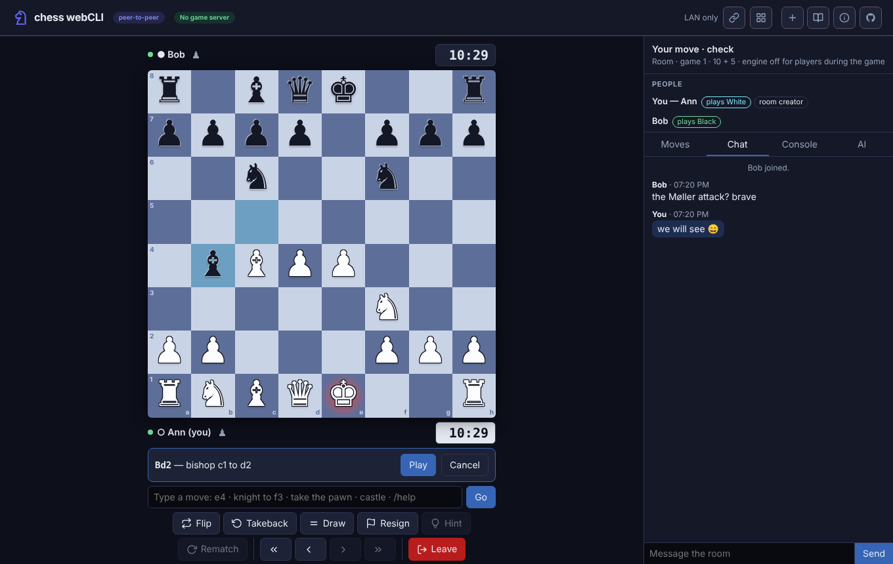
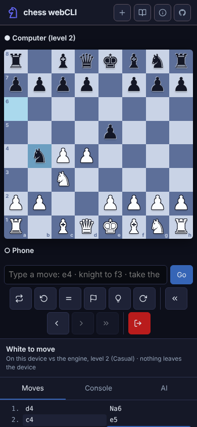

# chess webCLI

Chess rooms you open with a link, played directly between browsers. **Link in, game out.** No accounts and no game server: every move is signed by the player who made it and checked by every browser in the room. A small local engine plays you offline, and an **optional on-device language model** turns loose wording into a legal move. It can only choose from the legal moves, and you confirm before anything is played.



> Part of the **webCLI** family ([webcli.app](https://webcli.app)): same look, same discipline about what leaves your device. Like [rtc-webCLI](https://github.com/tejaswigowda/rtc-webCLI), **a room has to send**: your moves go to the people in the room, and introduction relays and a STUN server are contacted to set that up. Games on your own device send nothing. Every host is listed in the [egress table](#privacy--egress).

**Read more: [the About page](docs/about/index.html)** (served at `/about/`).

**Status: v0.1.0 (protocol 1). Not yet run on real devices across real networks.** `npm test` runs 150+ checks: the rules engine (perft against published counts), the engine, the move grammar, the model bounds (with scripted fake models), the signed log, and real Chrome pages playing each other over WebRTC through a mock relay. The model path has **not** been run on a real GPU, and **no model has been evaluated on this task yet**.

---

## Paper

This tool follows the **Web-CLI** architecture:

> **The Web-CLI: Verifiable Privacy for Tools, Models, and Inference Engines in the Browser**
> Tejaswi Gowda, Arizona State University. arXiv: https://arxiv.org/abs/2608.28950

On-device games are zero-egress. Rooms cannot be, because moves have to reach the other player; every request is declared and checkable in DevTools instead.

---

## At a Glance

| | |
|---|---|
| **in** | an invite link, or nothing (for a game on this device) |
| **out** | a game; PGN on your device if you save it |
| **not** | a rated server, matchmaking, adjudication or anti-cheat |
| **egress** | on-device games: none. Rooms: relays, STUN, the people in the room. Model: two download hosts, once, when you press Load |
| **fetches** | code: none from a CDN (self-hosted, hash-pinned) |
| **repro** | the engine is seeded: the same position, level and move number give the same reply |

---

## Key Features

- **Invite-link rooms**: `https://<origin>/#k=<128-bit secret>&s=<creator key id>`. Everything after `#` stays in the browser. The creator picks a colour (or random) and a clock; the first person to open the link takes the other colour, and everyone after watches.
- **A signed, replayed game log**: each move, offer, reply, resignation and flag is an event signed (ECDSA P-256) by the seat that wrote it and chained to the previous one by hash. Every peer replays every event through the rules engine. A modified page cannot move for you, make an illegal move, or accept a takeback, draw or rematch for you. A fork (two events at once) is settled the same way by every browser.
- **Full rules**: checks and pins, castling (not through or out of check), en passant (including the discovered-check case), promotion, checkmate, stalemate, threefold repetition, fifty-move rule, insufficient material. SAN, UCI, FEN and PGN in and out. Perft-tested against six published positions.
- **Clocks with increment**: 3+2 up to 30+0, or none. Self-reported by each mover and capped at what they had plus the increment. Flags are claimed automatically.
- **Takeback, draw and rematch by consent**, resignation, review of every move (arrow keys), watchers, chat, copy or save PGN (all games in the room), copy FEN.
- **Keep your seat through a reload**: your seat key and the log live in the tab's `sessionStorage`; reload and you are back in your seat. **Leave** deletes them.
- **Play on this device, offline**: against the local engine (5 levels, each bounded by depth, positions searched and time), pass and play, or an analysis board with FEN/PGN loading.
- **Type your moves**: notation (`e4`, `Nxe5`, `O-O`, `e7e8q`) plays at once; plain words ("knight to f3", "take the queen", "castle long", "kingside knight out", "bishop blocks on d2") go through a fixed grammar that can only return legal moves, and are proposed for you to confirm. Several matches become buttons.
- **Bounded on-device AI (optional)**: see below.
- **Engine off for players in a live room game**: hints and evaluation are offered to watchers, to games on your device, and to everyone after the game.
- **Console with GUI parity**: `/move`, `/flip`, `/takeback`, `/draw`, `/accept`, `/decline`, `/resign`, `/rematch`, `/new`, `/hint`, `/eval`, `/level`, `/describe`, `/fen`, `/pgn`, `/load`, `/first` `/prev` `/next` `/last`, `/seats`, `/peers`, `/chat`, `/invite`, `/qr`, `/ai`, `/sounds`, `/egress`, `/about`, `/leave`.
- **Verified libraries**: Trystero and the QR generator (the same builds rtc-webCLI pins) and WebLLM are vendored in `docs/lib/`; the page checks each file's SHA-256 against `js/app.js` and refuses to run on a mismatch.
- **Installable, opens offline (PWA)**, works on a phone (tested at 390 px wide), tooltips on every control, generated move sounds (no audio files).

<p align="center"></p>

---

## The bounded AI

The same split as [Strata](https://github.com/tejaswigowda/strata-editor): a deterministic layer does the work, and a model only handles the fuzzy residue, inside bounds that the code enforces.

```
typed text ──► notation?        ──► play it
           └─► grammar (intent.js): filter the legal moves ──► 1 match: propose   N matches: buttons
               └─► not placed, and a model is loaded:
                   model (ai.js) picks ONE id from a closed list ──► re-check in the rules engine ──► propose
```

| Bound | How it is enforced |
|---|---|
| Closed output | Decoding is constrained by a JSON schema whose only field is an `enum` of the legal moves, a few commands and `none`. The reply is parsed and checked against the list anyway. |
| Re-validated | A chosen move is looked up in the rules engine again before you see it. |
| Bounded effort | At most 3 attempts, 40 tokens each, temperature 0. |
| Proposal only | Nothing is played, sent, offered or resigned until you press the button. |
| Narrowed | If the grammar found candidates, the model chooses among only those. |
| Advice-free | The model is never shown an evaluation and never asked which move is good. |
| Local | Weights download once on an explicit click; inference runs in the tab (WebGPU); the prompt never leaves the device. |
| Allow-listed | Only the three listed models can be loaded; the library is given a config that names nothing else. |

Models (WebLLM builds): Qwen2.5 1.5B Instruct (default, ≈1.6 GB), Qwen2.5 0.5B Instruct (≈0.9 GB), Llama 3.2 1B Instruct (≈0.9 GB). WebGPU is needed (Chrome/Edge 113+ on most desktops). Everything else works without it. `test/ai-bounds.mjs` checks each bound with scripted fake models that answer validly, invalidly, illegally, and not at all.

---

## Usage

1. **Create a room.** Pick your colour and clock, press **Create a room**, then copy the link (link icon) or show the QR code.
2. **Your friend opens the link** and presses **Join room**. Your browser seats them in the other colour.
3. **Move** by dragging, by clicking a piece and then a square, or by typing in the bar under the board. Typed words are proposed; press **Play** (or Enter) to confirm.
4. **Offer** a draw or a takeback with the buttons; the other player sees an **Accept** button. After the game, **Rematch** swaps colours.
5. **Review** with ⏮ ◀ ▶ ⏭ or the arrow keys; **Save .pgn** keeps every game from the room.

On this device: **Play the computer**, **Pass and play** or **Analysis board** on the start screen. Nothing is sent.

---

## Privacy & Egress

| Purpose | Host | When |
|---|---|---|
| Page, scripts, `lib/` | the origin you loaded it from | always |
| Introduction relays | `no.str.cr`, `relay.wavlake.com`, `nostr.hifish.org`, `relay.notoshi.win`, `relay.dwadziesciajeden.pl` | rooms only |
| STUN | `stun.cloudflare.com:3478` | rooms only; off with **LAN only** |
| TURN | none | never built in |
| Peers | each person in the room, directly (WebRTC data channel) | rooms only |
| Model weights | `huggingface.co` (redirects to `*.hf.co`) | only after you press **Load model** |
| Model GPU library | `raw.githubusercontent.com` | only after you press **Load model** |

The page's Content-Security-Policy allows exactly these (plus `ws://localhost` for development). `/egress` prints the declared list next to the hosts the page has actually contacted. The relays are the five rtc-webCLI pins; public relays come and go, so replace them in `docs/js/app.js` when they stop passing messages.

**What each party can see.** People in the room: your moves, chat, self-asserted name and IP address. Relays: your IP, a room topic hash and encrypted connection data, never the secret or a move (`npm test` asserts that no relay frame contains the secret or a move). STUN: your IP. The page host: that you loaded the page, never the secret.

**Nothing is kept** beyond the tab: name, settings, seat key and game log are in `sessionStorage`, dropped when the tab closes, deleted on **Leave**. What stays outside the page: a `.pgn` you saved, a copied invite link, browser history, the app files the service worker caches, and a downloaded model (browser cache, until you clear site data).

**Verify in DevTools:** Network tab → play the computer: only requests to the page origin. Create a room: WebSockets to the relays above. Search the log for the characters after `#k=`: they appear nowhere.

---

## What it is and is not

- **No server means no referee**: no ratings, matchmaking or anti-cheat. Nothing stops someone consulting an engine in another tab. For playing people you know.
- **A game lives as long as its players**: if a player closes their tab, their seat key is gone and the game cannot be finished (a reload is fine).
- **Clocks are self-reported**, capped at remaining time plus increment.
- **A newcomer who arrives while the creator is away** trusts the people present for who holds the second seat (the creator's seat is pinned by the link). Moves themselves are always verified.
- **Networks that keep devices apart** (some guest, venue and corporate Wi-Fi) block peer-to-peer connections, and there is no relay server to fall back on.
- **The engine is modest**: no book, a few hundred thousand positions per move. Level labels are descriptive, not measured ratings.
- **Pieces are Unicode glyphs**, so they depend on your fonts.

---

## Running Locally

```bash
git clone https://github.com/tejaswigowda/chess-webCLI.git
cd chess-webCLI
npm install        # dev dependencies only; the app has no runtime dependencies
npm start          # http://127.0.0.1:8080/   (HOST=0.0.0.0 to serve your LAN)
npm test           # rules, engine, grammar, model bounds, signed log, two-browser end-to-end
npm run vendor     # re-copy lib/ and re-pin the hashes in docs/js/app.js
```

Or serve `docs/` with any static server (GitHub Pages works). Rooms need a secure context (https, or localhost).

### Layout

```
docs/index.html          the page (markup and styles)
docs/js/app.js           UI, rooms, console, clocks
docs/js/chess.js         rules engine (0x88), SAN/UCI/FEN/PGN
docs/js/log.js           the signed event log: replay, verify, settle forks
docs/js/engine.js        alpha-beta engine; engine-worker.js runs it off the main thread
docs/js/intent.js        the deterministic move grammar
docs/js/ai.js            the bounded model layer
docs/lib/                vendored, hash-pinned: trystero-nostr.js, qrcode.js, web-llm.js
test/                    rules.mjs, engine.mjs, ai-bounds.mjs, log.mjs, e2e.mjs, screens.mjs
```

### Tests and gates

| Gate | Check | Status |
|---|---|---|
| Rules | perft (6 positions, up to depth 4), SAN disambiguation, en passant pin, castling through check, all draw rules, FEN validation, PGN round trip | automated |
| Engine | finds mates, wins material, stays inside depth/node/time bounds, deterministic per seed | automated |
| Grammar | 20+ phrasings to legal moves, candidates, commands or "none" | automated |
| Model bounds | closed list, re-check, attempt cap, narrowing, allow-list | automated, fake models |
| Signed log | forged, illegal, out-of-turn, tampered, dropped and foreign events refused; consent; fork convergence; rematch; flag | automated |
| Rooms | seating, moves, refusals, a forged move, a watcher, takeback, reload keeps seat, draw, rematch, resignation, identical logs on 3 peers | automated, real Chrome + mock relay |
| Privacy | secret absent from relay frames and page requests; no move in relay frames; no non-origin fetch | automated |
| On-device | engine game, takeback, hint, reload restore, PGN load; only the page origin contacted | automated |
| Model on a real GPU | load, latency, accuracy on a phrase set | **open** |
| Real devices, real relays, real networks | phone ↔ laptop, different networks | **open** |

---

## License

GPL-3.0-only, like rtc-webCLI.
